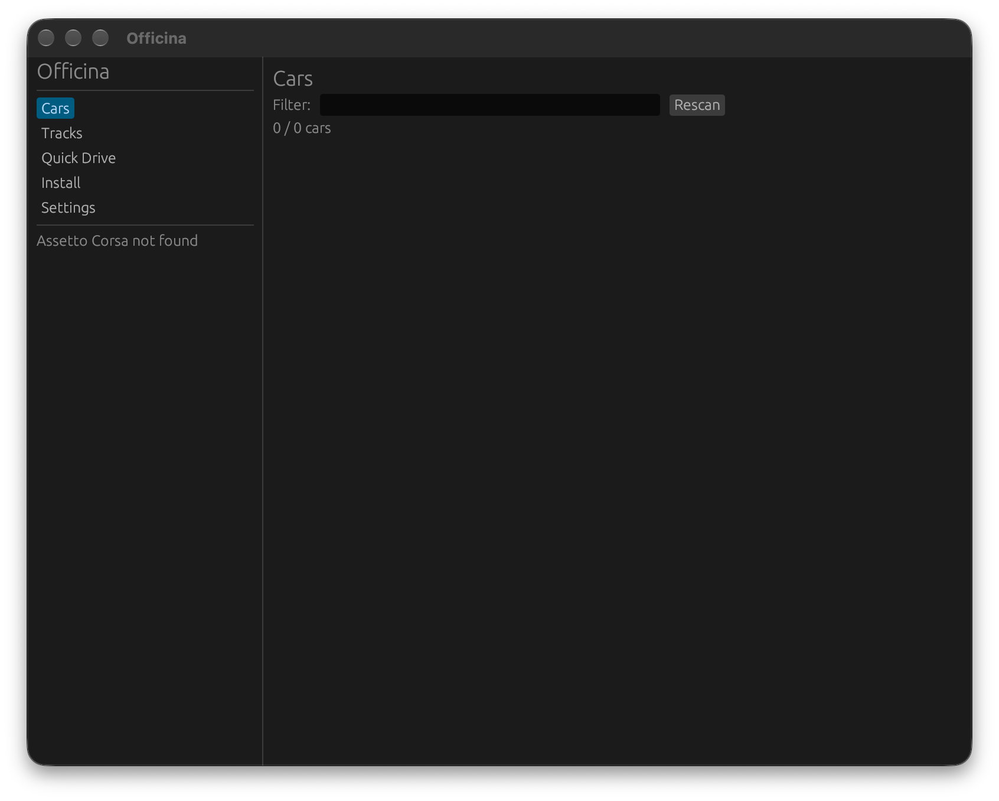

# 🏎️ Officina

Mod manager & launcher for **Assetto Corsa** on Linux (Bazzite, Steam Deck).

Native Rust + egui. No Electron, no .NET — just a small binary.



## ✨ Features

- 🚗 **Cars / 🏁 Tracks** — browse, filter, view specs, skins, badges
- ☁ **Weather** — browse presets, enable/disable
- 📂 **Setups** — manage car setups, apply in Quick Drive
- 📊 **Results** — race results and lap times
- 📦 **Mod installer** — drag & drop `.zip`/`.7z`/`.rar`/`.tar.gz` (cars, tracks, CSP, Sol, Pure)
- ⚡ **Quick Drive** — car/skin/track, sessions, laps, opponents, weather/time/temp
- 🏆 **Career & Special Events** — series progression, medals, launch
- ⚙️ **Game Settings** — video/audio/assists/gameplay/controls INIs
- 🔧 **Patches** — CSP/Sol/Pure detection & install
- 🔍 **Check Mods** — missing files, AI lines, liveries
- 📂 **acd pack/unpack** — decrypt/encrypt `data.acd`
- 🎮 **Gamepad** navigation (gilrs)
- 🔄 **Self-update** from GitHub Releases
- 🗑️ **Uninstall to trash**, enable/disable mods (JSGME-style)
- 💾 **Settings backups** with restore
- 🖥️ **CLI** — `officina where|list|install|check|acd`

## 🚀 Install

```sh
curl -fsSL https://raw.githubusercontent.com/matteocrippa/officina/main/install.sh | sh
```

Or build from source:

```sh
cargo build --release -p officina-app
./target/release/officina
```

Deps (Debian/Ubuntu): `build-essential pkg-config libxkbcommon-dev libwayland-dev libx11-dev libfontconfig-dev libvulkan-dev libudev-dev`

**Bazzite / immutable distros:** prefer the prebuilt release binary (install.sh downloads it automatically). Building from source requires a toolbox/distrobox container with the dev packages; system packages can't be installed on the host. Bazzite users can install Proton-GE via `ujust install-proton-ge`.

## ⌨️ CLI

```sh
officina where
officina list cars|tracks|weather|events
officina install mod.zip
officina check
officina acd unpack data.acd [out_dir]
officina acd pack data_dir [data.acd]
```

## 🎮 Steam Deck / Game Mode

Officina runs on Steam Deck. Recommended flow:

1. **First-time setup in Desktop Mode** — install Assetto Corsa, run it once from Steam (creates the Proton prefix), and run the upstream setup script if needed.
2. Add `officina` to Steam as a **Non-Steam Game** (Library → Add a Game → Add a Non-Steam Game) so it appears in the Game Mode library grid.
3. In the shortcut properties, enable **"Use Steam Input"** so the Deck controls and on-screen keyboard work in text fields.
4. Launch from Game Mode. Gamescope scaling may need tuning; text-heavy views are easier with the on-screen keyboard.

Desktop Mode remains the easiest place for mod installs and file management; Game Mode works well for launching and Quick Drive.

## ⚙️ Config

`~/.config/officina/settings.toml` — AC root & Proton auto-detected, overridable.

## 📁 Structure

- `crates/officina-core` — domain logic (no UI)
- `crates/officina-app` — egui app + CLI

## 📜 License

MIT — see [LICENSE.md](LICENSE.md). AC formats follow AcTools (MS-PL, © gro-ove).